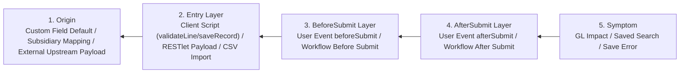

# Root-Cause Tracing in NetSuite & MCP Systems

## Overview

Bugs in enterprise ERP systems often manifest deep in the execution chain — for example, a Balance Sheet variance, an `INVALID_KEY_OR_REF` error on `record.save()`, a `RCRD_HAS_BEEN_CHANGED` collision, or a `[suiteqlGuard]` rejection.

**Core principle:** Trace backward through the execution and data chain until you find the original trigger, then fix at the source. Never patch the symptom at the end of the pipeline.

---

## 1. The NetSuite Execution Chain (Backward Tracing Map)

When a transaction or record exhibits corrupted data or throws an error on save, trace **backward** from the symptom to the origin:



### Step-by-Step Backward Trace Protocol

1. **Observe the Symptom (Layer 5)**
   - Example: Sales Order `SO1005` fails to bill, or its `transactionline.amount` does not match `quantity * rate`.
2. **Inspect the Audit Trail & Script Logs Concurrently (Layers 4 & 3)**
   - Call `netsuite_get_system_notes({ recordIds: ["<internalId>"] })` and `netsuite_get_script_logs` in the same turn.
   - Check the exact sequence of field changes in `systemnote`:
     - Did the field start with the wrong value on `Create` (pointing to Layer 1/2: RESTlet payload, CSV Import, or Client Script)?
     - Or was it set correctly on `Create` and immediately overwritten seconds later by `System` / a specific script context (pointing to Layer 3/4: a User Event `afterSubmit` or Workflow)?
3. **Isolate the Offending Script or Integration**
   - Once you identify which script or workflow touched the field last, inspect its source code.
   - Trace the variable inside the script backward:
     - Did `rec.getSublistValue({ sublistId: 'item', fieldId: 'rate', line: i })` return a string instead of a number?
     - Did a `N/query` lookup return `null` because `isinactive = 'T'` or because `mainline = 'F'` was omitted?
4. **Fix at the Origin (Layer 1/2/3)**
   - ❌ **BAD (Symptom Masking)**: Writing a scheduled script to periodically overwrite corrupted amounts back to the right value.
   - ✅ **GOOD (Root Cause Fix)**: Fixing the calculation and type coercion directly in the `beforeSubmit` User Event script where the line item is computed.

---

## 2. Tracing Common NetSuite Runtime Errors to Their True Source

| Observed Error / Symptom | Naive (Wrong) Assumption | True Root Cause to Trace |
|:---|:---|:---|
| `RCRD_HAS_BEEN_CHANGED` during User Event execution | "Two users clicked save at the same time; add retry logic." | The script is calling `record.submitFields` or `record.load` + `record.save()` on the **same record** inside `beforeSubmit` (or before another chained workflow finishes). Mutate `context.newRecord` directly in `beforeSubmit` instead! |
| `SSS_USAGE_LIMIT_EXCEEDED` in User Event or Suitelet | "Remove a few searches to save 20 governance units." | O(N) architecture defect: calling `record.load()`, `record.submitFields()`, or `query.runSuiteQL()` **inside a `for` loop** over transaction lines. Replace the loop with a single batched `N/query` (`WHERE id IN (...)`) or move bulk processing to `Map/Reduce`. |
| SuiteQL error: `Syntax error near: FETCH` | "`FETCH FIRST N ROWS ONLY` is broken; replace with `ROWNUM` or `LIMIT`." | Oracle's parser fails at `FETCH` whenever the **preceding** `SELECT` column list, `WHERE` clause, or `GROUP BY` has a syntax error or non-existent column. Trace backward to the clause immediately before `FETCH`. |
| Duplicate rows (3x–10x inflation) in SuiteQL `transaction` + `transactionline` query | "Add `SELECT DISTINCT` to deduplicate the output." | Missing `tl.mainline = 'F'` and `tl.taxline = 'F'`, or joining a one-to-many table (like `transactionaccountingline` or multiple item locations) without pre-aggregating in a `WITH` CTE. Fix the join cardinality, never slap `DISTINCT` over a Cartesian product. |
| `INVALID_KEY_OR_REF` for `entity`, `item`, or `location` | "The internal ID doesn't exist." | Often the internal ID *does* exist, but it belongs to a different **Subsidiary** than the transaction header, or `isinactive = 'T'`, or the subsidiary does not share that item/account. Query both records' `subsidiary` and `isinactive` columns via `netsuite_run_suiteql`. |

---

## 3. Tracing in the `@suiteinsider/netsuite-mcp` Server

When debugging an issue inside this TypeScript MCP codebase (`src/`):

```text
MCP Client Tool Call
  └──> src/index.ts (Tool Dispatch & Zod Argument Parsing)
        └──> src/handlers/*.ts (Environment Lock, Batch Fan-Out, Cache Lookup)
              └──> src/utils/suiteqlGuard.ts (Static AST / Regex Validation)
                    └──> src/mcp/*.ts (ConcurrencyLimiter(5), OAuth 2.0 PKCE Header, Axios REST/SuiteQL Call)
                          └──> src/utils/contextSlimmer.ts (Payload Truncation & Formatting)
```

1. **Reproduce via `node:test`**: Never guess why `validateSuiteQL` or `contextSlimmer` behaved unexpectedly. Write a 5-line test in `test/` passing the exact input string.
2. **Trace Layer by Layer**:
   - Did `splitSuiteQLStatements` split a semicolon inside a string literal?
   - Did `stripCommentsAndStrings` strip a valid token or leave a comment block intact?
   - Trace the exact helper function returning the wrong intermediate value and fix that helper directly.
