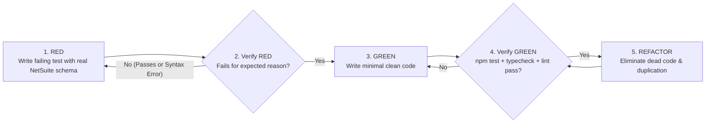

# NetSuite & MCP Test-Driven Development (TDD)

## Overview

Write the test first. Watch it fail. Write minimal, authoritative code to pass.

**Core principle:** If you didn't watch the test fail, you cannot prove it tests the right NetSuite behavior or catches the regression.

**Violating the letter of the rules is violating the spirit of the rules.**

## The Iron Law

```text
NO PRODUCTION CODE WITHOUT A FAILING TEST FIRST
```

Did you write implementation code in `src/` or a SuiteScript module before writing the test? **Delete it. Start over.**
- Do not keep it as "reference".
- Do not "adapt" it while writing tests after the fact.
- Implement fresh from the failing test.

---

## When to Use

**Always apply this skill for:**
1. **MCP Server & Guardrail Development (`@suiteinsider/netsuite-mcp`)**:
   - Adding or modifying rules in `src/utils/suiteqlGuard.ts`
   - Updating payload truncation or formatting in `src/utils/contextSlimmer.ts`
   - Modifying environment isolation in `src/utils/environment.ts`
   - Adding or refactoring MCP handlers in `src/handlers/`
2. **SuiteScript 2.1 Development & Bug Fixes**:
   - Financial calculations, tax/discount proration, currency conversion, and date/period math
   - Payload validation and transformation for RESTlets and external integrations
   - SuiteQL result-set mapping and aggregation logic
   - Fixing any bug identified via `netsuite-systematic-debugging`

---

## The Red-Green-Refactor Cycle



---

## Track A: TDD in `@suiteinsider/netsuite-mcp` (`node:test`)

This repository uses Node.js native test runner with `tsx` (`npm test` -> `node --import tsx --test 'test/**/*.test.ts'`) and `node:assert/strict`.

### Step 1: RED — Write a Failing `node:test` Case

<Good>
```typescript
import assert from "node:assert/strict";
import { describe, it } from "node:test";
import { validateSuiteQL } from "../../src/utils/suiteqlGuard.js";

describe("suiteqlGuard: item.recordtype prohibition", () => {
	it("blocks fabricated column item.recordtype and suggests itemtype/subtype", () => {
		const sql =
			"SELECT i.id, i.itemid, i.recordtype FROM item i WHERE i.isinactive = 'F' FETCH FIRST 10 ROWS ONLY";
		const res = validateSuiteQL(sql);
		assert.strictEqual(res.valid, false);
		assert.ok(
			res.errors.some((e) => e.includes("Invalid Column on 'item' Table: 'recordtype'")),
		);
	});
});
```
*Why this is Good:* Uses `node:test` and `node:assert/strict`, tests the real `validateSuiteQL` function without mocks, and asserts on the exact diagnostic guardrail tag.
</Good>

<Bad>
```typescript
// BAD: Testing a mock or writing a vague assertion after already changing suiteqlGuard.ts
it("works", () => {
	const res = validateSuiteQL("SELECT * FROM item");
	assert.ok(!res.valid); // Tests wildcard rule, not item.recordtype!
});
```
</Bad>

### Step 2: Verify RED — Watch It Fail

**MANDATORY. Never skip.**

```bash
npm test
```

Confirm:
- The new test **FAILS** (not a TypeScript compilation error or import typo).
- It fails specifically because the new rule or behavior is not yet implemented.

### Step 3: GREEN — Write Minimal Authoritative Code

Implement the clean solution in `src/` adhering strictly to `AGENTS.md`:
- Zero `any` (use `unknown` + type narrowing or Zod).
- Explicit `.js` extension on all relative ESM imports.
- Zero dual-track compatibility branches.

### Step 4: Verify GREEN & Run Quality Gates

Run the complete verification pipeline:
```bash
npm test
npm run typecheck
npm run lint
npm run build
```
All 4 commands must exit with **0 errors and 0 warnings**.

---

## Track B: TDD in NetSuite SuiteScript 2.1 (Pure Core, Imperative Shell)

NetSuite's `N/record`, `N/query`, and `N/runtime` modules execute on Oracle's Rhino/GraalVM server runtime. The biggest anti-pattern in SuiteScript testing is writing giant mock objects for `N/record` that only test whether `mockRecord.setValue` was called with a guessed field ID.

Instead, enforce the **Pure Core, Imperative Shell** pattern:

### 1. Decouple Pure Business Logic from `N/*` Modules
Extract all calculation, line-item filtering, proration, and payload transformation into pure functions (or a dedicated helper module) that accept plain JavaScript objects/arrays with **verified NetSuite field IDs** and return plain data structures.

<Good>
```javascript
// Pure Core: Prorates header shipping discount across eligible transaction lines
// Easy to test with node:test in < 10ms without mocking N/record!
export function calculateLineDiscountAllocations(lines, totalHeaderDiscount) {
	const eligibleLines = lines.filter(
		(l) => l.mainline === "F" && l.taxline === "F" && l.amount > 0,
	);
	const totalAmount = eligibleLines.reduce((sum, l) => sum + l.amount, 0);
	if (totalAmount === 0) return [];

	let allocatedSoFar = 0;
	return eligibleLines.map((line, idx) => {
		const isLast = idx === eligibleLines.length - 1;
		const allocation = isLast
			? Number((totalHeaderDiscount - allocatedSoFar).toFixed(2))
			: Number(((line.amount / totalAmount) * totalHeaderDiscount).toFixed(2));
		allocatedSoFar = Number((allocatedSoFar + allocation).toFixed(2));
		return {
			linesequencenumber: line.linesequencenumber,
			discountAmount: allocation,
		};
	});
}
```
</Good>

### 2. Write the Failing Test First (Covering Edge Cases like Rounding Penny Drift)
```typescript
import assert from "node:assert/strict";
import { describe, it } from "node:test";
import { calculateLineDiscountAllocations } from "./discountAllocator.js";

describe("calculateLineDiscountAllocations", () => {
	it("allocates $10.00 across 3 equal lines without losing 1 cent to rounding drift", () => {
		const lines = [
			{ linesequencenumber: 1, mainline: "F", taxline: "F", amount: 100 },
			{ linesequencenumber: 2, mainline: "F", taxline: "F", amount: 100 },
			{ linesequencenumber: 3, mainline: "F", taxline: "F", amount: 100 },
		];
		const result = calculateLineDiscountAllocations(lines, 10.0);
		assert.deepStrictEqual(result, [
			{ linesequencenumber: 1, discountAmount: 3.33 },
			{ linesequencenumber: 2, discountAmount: 3.33 },
			{ linesequencenumber: 3, discountAmount: 3.34 }, // Last line absorbs rounding remainder!
		]);
	});
});
```

### 3. Keep the `N/record` Imperative Shell Thin & Verify with Live SuiteQL
Keep the User Event / MapReduce entry point thin: read fields from `context.newRecord`, pass them to the tested pure function, and write the results back.
When testing in a NetSuite Sandbox (`*_sb*`), write your **verification SuiteQL query (`netsuite_run_suiteql`)** before triggering the script so you have an objective, deterministic assertion on the resulting database state.

When writing or changing any test, read [writing-good-tests.md](writing-good-tests.md) for the rules that keep NetSuite and MCP tests honest.

---

## Common Rationalizations vs. Reality

| Excuse | Reality |
|:---|:---|
| "SuiteScript runs in NetSuite, so I can't do TDD locally" | 80% of SuiteScript bugs are in data transformation, math, null handling, and condition branching — all of which can be extracted into pure functions and tested locally via `node:test` in milliseconds. |
| "I'll write the `suiteqlGuard` regex first and add tests after" | Tests written after pass immediately — you never proved the test catches the invalid SQL, and you are biased by the regex you just wrote. Write the failing SQL test case first. |
| "I already tested the query manually in one account" | Ad-hoc manual runs aren't repeatable when someone refactors `suiteqlGuard.ts` next month. Codify edge cases in `test/suiteql/suiteqlGuard.test.ts`. |
| "Too simple to test" | A 1-line regex change in `suiteqlGuard` can accidentally block valid CTEs across all accounts. Writing a `node:test` case takes 30 seconds. |

---

## Verification Checklist

Before marking any implementation complete:

- [ ] Every new function, guardrail rule, or calculation has a test.
- [ ] Watched each test **FAIL (RED)** for the expected reason before writing production code.
- [ ] Test fixtures use **verified NetSuite field IDs and table names** (never fabricated columns like `item.recordtype` or `transaction.createdfrom`, unless testing that `suiteqlGuard` rejects them).
- [ ] Wrote minimal, single-track code to pass each test (zero legacy fallback branches).
- [ ] `npm test`, `npm run typecheck`, `npm run lint`, and `npm run build` all pass with 0 errors.
